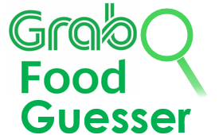
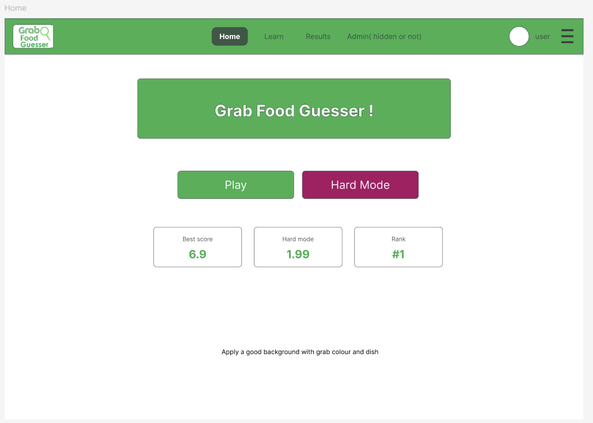
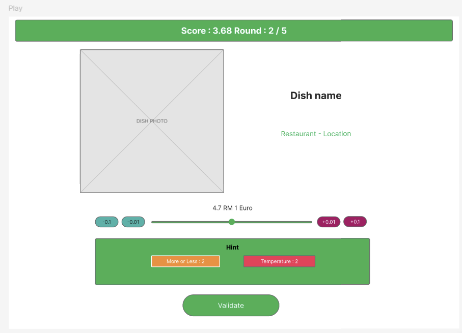
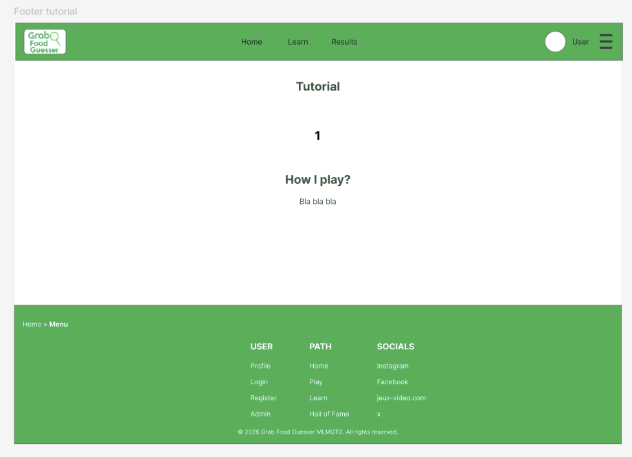
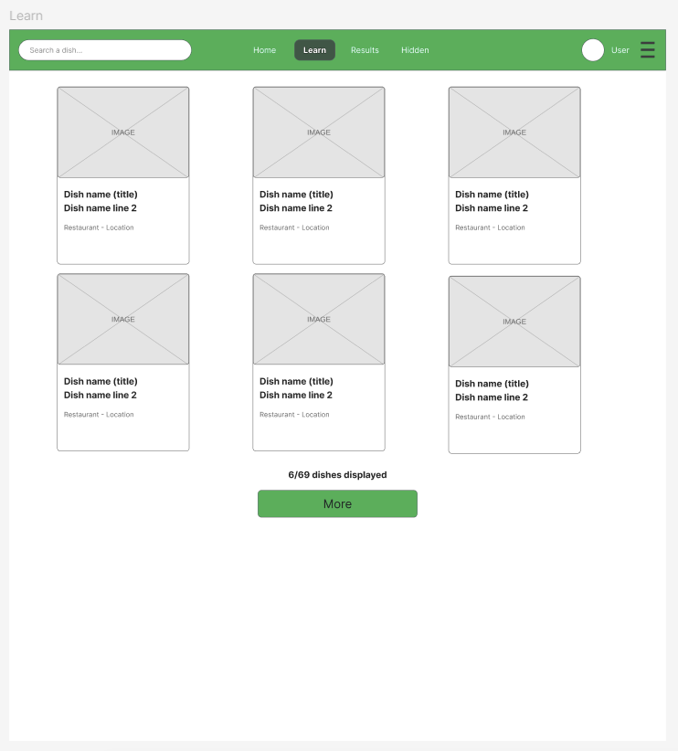
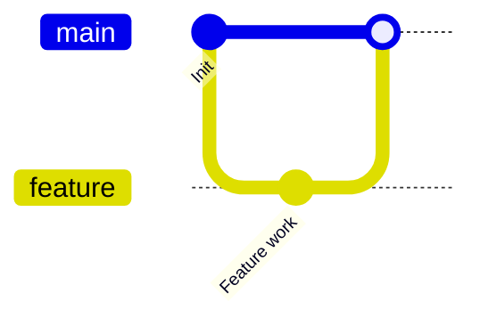
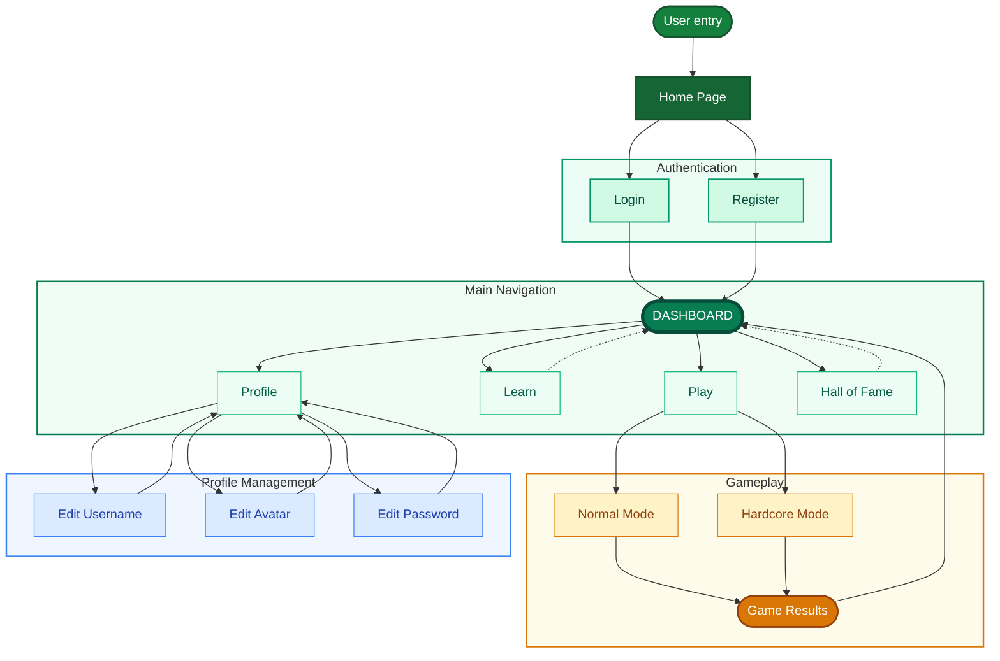
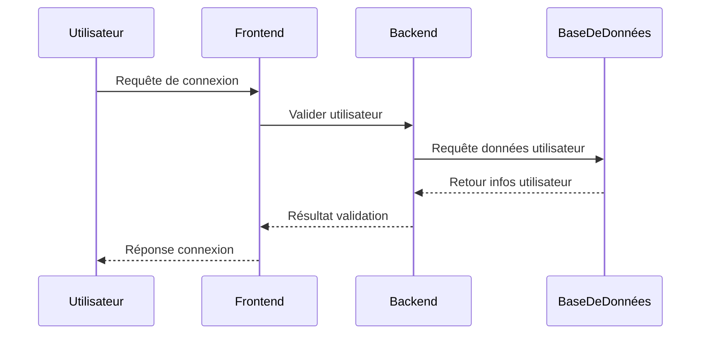

# GRAB FOOD GUESSER

---

**Institution:** _Asia Pacific University (APU)_

**Intake Code:** _CX010-2.5-3-AWP_

**Academic Year:** _2026_

**Subject:** _Advanced Web Programming Project_

**Project Title:** _GRAB FOOD GUESSER_

---

### Team Members

| Name             | Student ID |
| ---------------- | ---------- |
| Mathias Leroy    | TP193497   |
| Matthieu Galland | TP193475   |
| Timothée Girault | TP193489   |

---

## Contents

1. [Project Overview](#project-overview)
2. [Installation and Setup](#installation-and-setup)
3. [Project Design](#project-design)
4. [Implementation](#implementation)
5. [User Guide](#user-guide)
6. [Conclusion](#conclusion)
7. [Contributing](#contributing)
8. [References](#references)

---

## Project Overview

<div align="center">
  
</div>

#### Aim of the project

As part of our **Advanced Web Programming (CX010-2.5-3-AWP) course** at APU, we are required to develop a website based on a topic of our choice. The project must meet the following technical requirements:

- Develop a web interface that includes multiple pages.
- Create a web server equipped with an API.
- Establish communication with a SQL-based data persistence system.
- Implement user authentication using standard security mechanisms.
- Enable a Single Page Application (SPA) to communicate with a Node.js web server.

#### Project Concept: Grab Food Guesser

The aim of our project is to help users discover Malaysian cuisine through an interactive price-guessing game.

Each dish is presented with a description to help users learn more about Malaysian food and its culinary culture. Players must guess the price of each dish and compare their estimates with the actual prices.

Through this game, users can explore local specialties, discover new dishes, and learn more about Malaysian cuisine in an entertaining and engaging way.

---

## Installation and Setup

Follow these steps to install and run the project locally.

### 1. Download the project

- Download the project ZIP file.
- Extract its contents into a folder.
- Open the project folder in your preferred IDE.

### 2. Configure environment variables

- Create a `.env` file in the root directory of the project.
- Copy paste the `.env.exemple`
- Add your local MySQL database password:

```env
DATABASE_PASSWORD='your_password'
```

Replace `your_password` with your actual MySQL password.

### 3. Set up the database

- Start your MySQL server.
- Connect to your local MySQL instance.
- Open the SQL scripts provided in the project.
- Execute the scripts to create and initialize the database.

### 4. Install dependencies

Make sure [Node.js](https://nodejs.org/) is installed on your computer.

Open a terminal in the project's root directory and run:

```bash
npm install
```

If Express is not already listed as a dependency, install it with:

```bash
npm install express
```

### 5. Start the application

Run the following command in your terminal:

```bash
node app.js
```

### 6. Access the application

Once the server has started successfully, open your browser and navigate to:

[http://localhost:3000/](http://localhost:3000/)

The web application should now be accessible locally.

---

## Project Design

### Table Definitions

#### Dish table

```sql
CREATE TABLE IF NOT EXISTS produit (
    id INT AUTO_INCREMENT PRIMARY KEY,
    nom VARCHAR(255) NOT NULL,
    nom_restaurant VARCHAR(255) NOT NULL,
    prix DECIMAL(10, 2) NOT NULL,
    image VARCHAR(255)
);
```

| Column         | Type           | Nullable | Default | Description                               |
| -------------- | -------------- | -------- | ------- | ----------------------------------------- |
| id             | UUID           | No       | -       | Primary key, auto-generated server-side   |
| nom            | VARCHAR(255)   | No       | -       | The name of the dish                      |
| nom_restaurant | VARCHAR(255)   | No       | -       | Display the restaurant name from the dish |
| prix           | DECIMAL(10, 2) | No       | -       | The dish price                            |
| image          | VARCHAR(255)   | Yes      | -       | The variable keep the image path          |

#### Game table

```sql
CREATE TABLE IF NOT EXISTS partie (
    id INT AUTO_INCREMENT PRIMARY KEY,
    score DECIMAL(10, 2) DEFAULT 0,
    round INT DEFAULT 1,
    hint_count INT DEFAULT 2,
    temp_count INT DEFAULT 2,
    produit_actuel INT,
    FOREIGN KEY (produit_actuel) REFERENCES produit(id)
);

```

| Column         | Type                                               | Nullable | Default | Description                                                                |
| -------------- | -------------------------------------------------- | -------- | ------- | -------------------------------------------------------------------------- |
| id             | UUID                                               | No       | -       | Primary key, auto-generated server-side                                    |
| score          | DECIMAL(10, 2)                                     | No       | 0       | Keep the player score in the data                                          |
| round          | INT                                                | No       | 1       | Count the number of the round                                              |
| hint_count     | INT                                                | No       | 2       | Count the remaining hints (in this case more or less)                      |
| temp_count     | INT                                                | No       | 2       | Count the remaining hints (in this case temperature far or near the price) |
| produit_actuel | OREIGN KEY (produit_actuel) REFERENCES produit(id) | No       | -       | Retrieve the actuel dish that would be guess by the player                 |

#### User table

```sql
CREATE TABLE IF NOT EXISTS users (
    id INT AUTO_INCREMENT PRIMARY KEY,
    nickname VARCHAR(255) NOT NULL UNIQUE,
    email VARCHAR(255) NOT NULL UNIQUE,
    hash_password VARCHAR(255) NOT NULL,
    creation_date datetime NOT NULL DEFAULT CURRENT_TIMESTAMP,
    user_role ENUM('Admin', 'Player') DEFAULT 'Player' NOT NULL,
    best_score DECIMAL(10,2) NULL,
    best_hard_score DECIMAL(10,2) NULL,
    avatar VARCHAR(255) DEFAULT '/images/avatars/avatar1.png'
);
```

| Column          | Type                    | Nullable | Default                                                           | Description                                             |
| --------------- | ----------------------- | -------- | ----------------------------------------------------------------- | ------------------------------------------------------- |
| id              | UUID                    | No       | -                                                                 | Primary key, auto-generated server-side                 |
| nickname        | VARCHAR(255)            | No       | -                                                                 | Login email, globally unique, case-insensitive matching |
| email           | VARCHAR(255)            | No       | -                                                                 | Display name shown in the application UI                |
| hash_password   | VARCHAR(255)            | No       | -                                                                 | Permission level: admin, member, or viewer              |
| creation_date   | datetime                | No       | CURRENT_TIMESTAMP                                                 | Account creation time (stored as UTC)                   |
| user_role       | ENUM('Admin', 'Player') | No       | 'Player'                                                          | Soft delete marker (null = active record)               |
| best_score      | DECIMAL(10,2)           | Yes      | NULL                                                              | Stock the best score of the player in normal mode       |
| best_hard_score | DECIMAL(10,2)           | Yes      | NULL                                                              | Stock the best score of the player in hard mode         |
| avatar          | VARCHAR(255)            | No       | '/images/avatars/avatar1.png' (The first image of avatar galerie) | Keep in memory the avatar patch of the player           |

---

### Entity Relationship Diagrams

---

## Wireframes

We designed our website wireframes using **Figma**. You can access our designs through the following link:

[Figma](https://www.figma.com/design/9DfsoZ4DDwyEWT69YZjyab/Untitled?node-id=14-95&t=hTyXFCZIWmZ8ebrY-1)

### Design and Colour Choices

For the visual identity of our website, we chose Grab's signature green (`#00B14F`) as our primary colour. We then selected complementary colours using a colour wheel to create a consistent and visually appealing colour palette.

Colour palette reference: [HTML Colour Wheel](https://www.htmlcouleur.com/cercle-chromatique#00b14f)

Our main objective was to create a **simple, intuitive and user-friendly website**. We wanted the interface to be easy to understand and accessible to all players, while keeping a playful design inspired by Grab's visual identity.

### Home Page

The home page serves as the main entry point to the application. It provides access to the different sections of the website through the navigation bar: Home, Learn, Hall of Fame and the Admin Panel (available only to administrators).

A hamburger menu icon allows users to open a sidebar containing additional options, such as settings and logout. Users can also access their profile page by clicking on their avatar.

The central part of the page displays the website's name and two main buttons, allowing players to choose between the two available game modes: **Normal Mode** and **Hardcore Mode**.

Finally, the home page includes a player statistics section, displaying important information such as their highest score, ranking and best Hardcore Mode score.

<div align="center">
  
</div>

### Game Page

The game page was designed to provide a straightforward and intuitive gaming experience.

Players can adjust their price estimate using a slider controlled with their mouse or through adjustment buttons. These buttons allow them to increase or decrease their guess with different increments, making price adjustments more precise.

At the top of the page, a game summary displays the current round, the player's total score and their score for each round. This allows players to keep track of their progress throughout the game.

<div align="center">
  
</div>

### Tutorial and Footer

The tutorial section is designed to help new players understand the rules and mechanics of the game before starting their first round.

The footer provides additional navigation links and useful information, allowing users to easily access the different sections of the website.

<div align="center">
  
</div>

### Learn Page

The Learn page is dedicated to discovering Malaysian food. It provides players with information about different Malaysian dishes, helping them become more familiar with the country's culinary culture.

This section complements the game by allowing users to learn more about the dishes they may encounter while playing.

<div align="center">
  
</div>

---

## Implementation

---

## User Guide

---

## Conclusion

---

## References

---

---



Website Navigational Structure



## How to Format Database Schemas in Markdown

Use text-based diagrams to show how tables connect. Keep them simple and readable in plain text:



For more detail, add a relationship reference table documenting foreign keys and delete behavior:

| Parent | Child     | FK Column | Cardinality | ON DELETE | Notes                                |
| ------ | --------- | --------- | ----------- | --------- | ------------------------------------ |
| users  | posts     | author_id | 1:N         | CASCADE   | Deleting user deletes their posts    |
| users  | comments  | author_id | 1:N         | CASCADE   | Deleting user deletes their comments |
| posts  | comments  | post_id   | 1:N         | CASCADE   | Deleting post deletes its comments   |
| posts  | post_tags | post_id   | 1:N         | CASCADE   | Junction table for many-to-many      |
| tags   | post_tags | tag_id    | 1:N         | CASCADE   | Junction table for many-to-many      |

# Contributing

- [Mathias](https://github.com/mathas42) :
- [ Matthieu](https://github.com/MatthieuGalland) :
- [Timothée](https://github.com/Elfvelour) :
