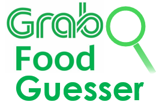
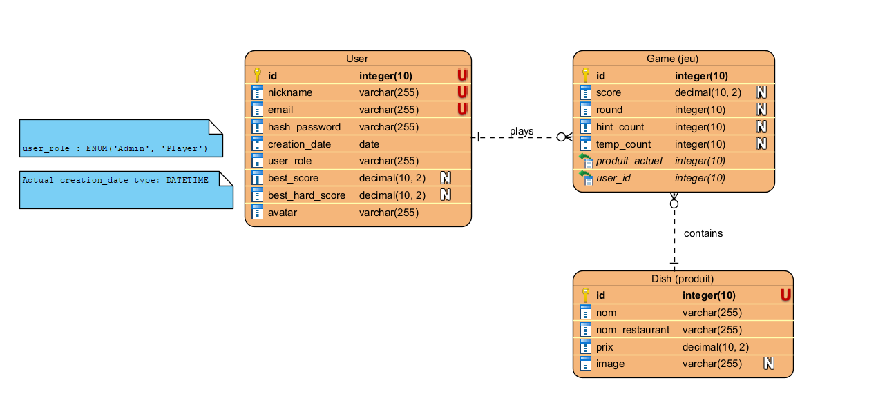
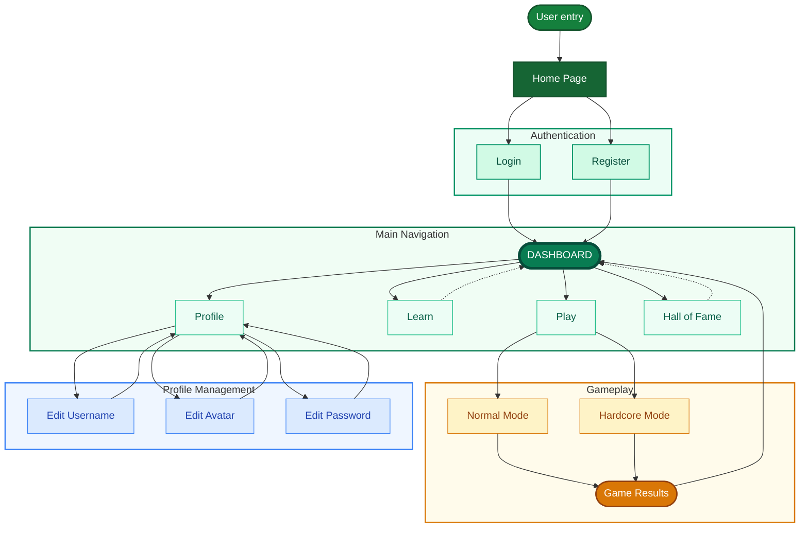
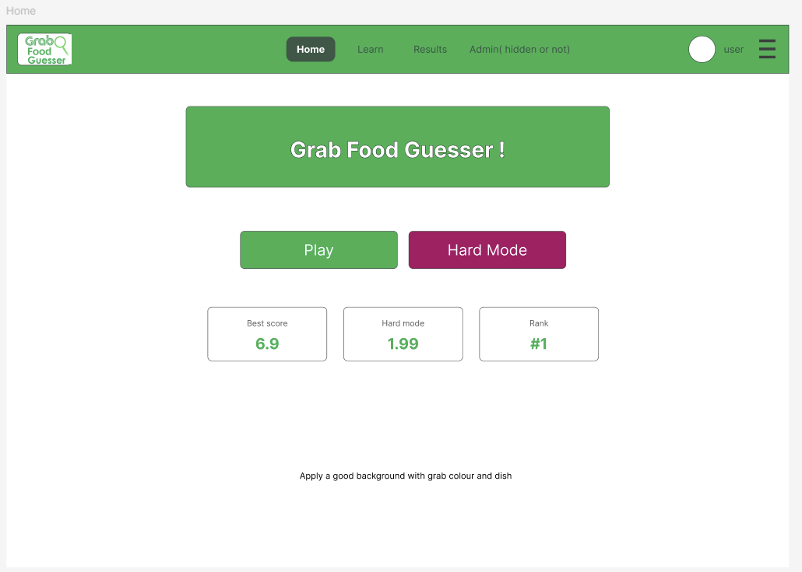
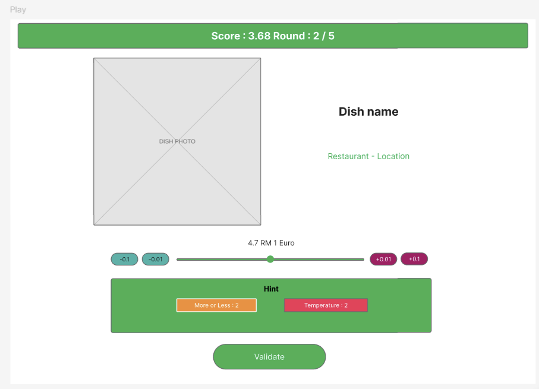
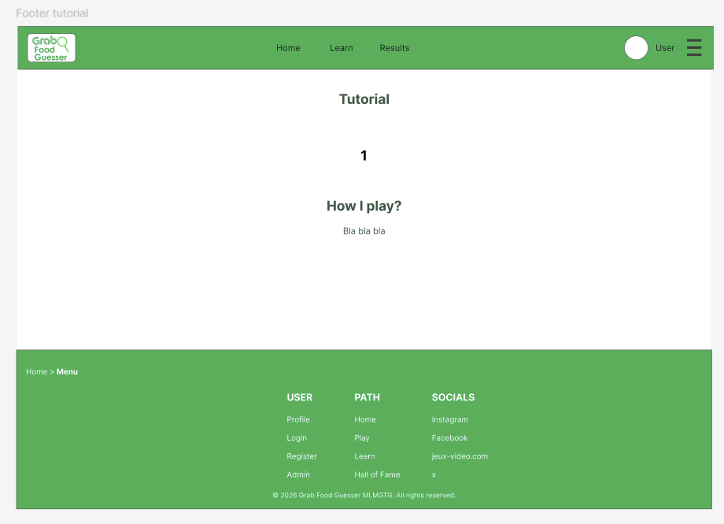
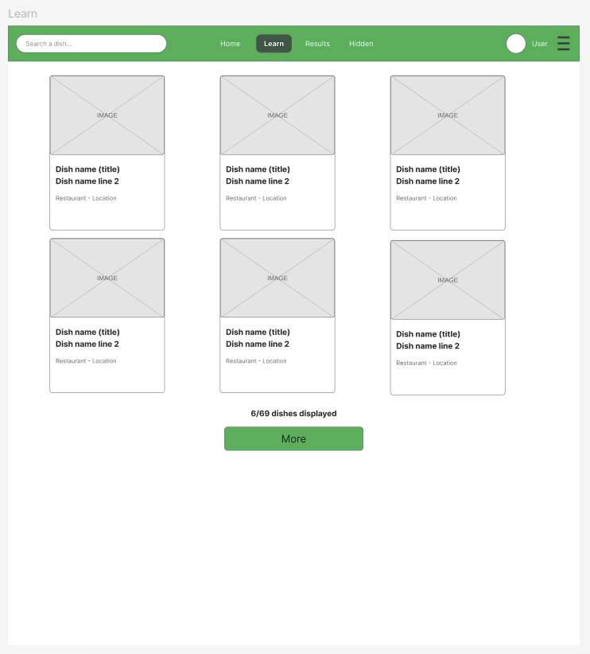
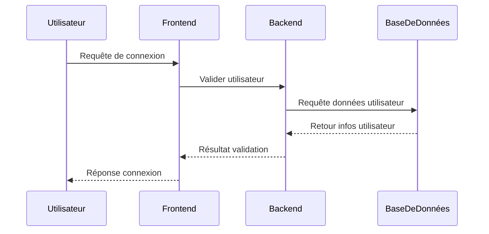

# GRAB FOOD GUESSER

---

**Institution:** _Asia Pacific University (APU)_

**Intake Code:** _CX010-2.5-3-AWP_

**Academic Year:** _2026_

**Subject:** _Advanced Web Programming Project_

**Project Title:** _GRAB FOOD GUESSER_

---

### Team Members

| Name             | Student ID |
| ---------------- | ---------- |
| Mathias Leroy    | TP193497   |
| Matthieu Galland | TP193475   |
| Timothée Girault | TP193489   |

---

## Contents

1. [Project Overview](#project-overview)
2. [Installation and Setup](#installation-and-setup)
3. [Project Design](#project-design)
4. [Implementation](#implementation)
5. [User Guide](#user-guide)
6. [Conclusion](#conclusion)
7. [Contributing](#contributing)
8. [References](#references)

---

## Project Overview

<div align="center">
  
</div>

#### Aim of the project

As part of our **Advanced Web Programming (CX010-2.5-3-AWP) course** at APU, we are required to develop a website based on a topic of our choice. The project must meet the following technical requirements:

- Develop a web interface that includes multiple pages.
- Create a web server equipped with an API.
- Establish communication with a SQL-based data persistence system.
- Implement user authentication using standard security mechanisms.
- Enable a Single Page Application (SPA) to communicate with a Node.js web server.

#### Project Concept: Grab Food Guesser

The aim of our project is to help users discover Malaysian cuisine through an interactive price-guessing game.

Each dish is presented with a description to help users learn more about Malaysian food and its culinary culture. Players must guess the price of each dish and compare their estimates with the actual prices.

Through this game, users can explore local specialties, discover new dishes, and learn more about Malaysian cuisine in an entertaining and engaging way.

##### Our website offers five main functionalities:

- **User Authentication**: A login and registration interface that allows users to create an account and securely access their personal profile.

- **Admin Panel**: An administration interface that allows administrators to manage the website and its content.

- **Price Guessing Game**: The main feature of our application. Players must guess the correct price of different Malaysian dishes. Two game modes are available: Normal Mode and Hardcore Mode, offering different levels of difficulty.

- **Dish Gallery (Learn Page)**: A gallery displaying the different Malaysian dishes available in the game, along with their descriptions and additional information to help users discover Malaysian cuisine.

- **Hall of Fame**: A leaderboard displaying the players results and scores, allowing users to compare their performance with other players.

---

## Installation and Setup

Follow these steps to install and run the project locally.

### Prerequisites

Before starting, make sure you have installed the following software:

- **[Node.js](https://nodejs.org/)** – Required to run the application and manage its dependencies.
- **[MySQL Server](https://dev.mysql.com/downloads/mysql/)** – Required to host the project database.

### 1. Download the project

- Download the project ZIP file or clone the Git repository.
- Extract its contents into a folder.
- Open the project folder in your preferred IDE.
- Make sure you are in the project's root directory before running the following commands.

### 2. Configure environment variables

- Create a `.env` file in the root directory of the project.
- Copy the contents of `.env.example` into your new `.env` file.
- Configure your local MySQL database credentials.

Example:

```env
DATABASE_PASSWORD='your_password'
```

Replace `your_password` with your actual MySQL password.

Make sure to keep your `.env` file private and never commit it to Git.

### 3. Set up the database

- Start your MySQL server.
- Connect to your local MySQL instance.
- Open the SQL scripts provided in the project.
- Execute the scripts to create and initialize the database.

Make sure the database is correctly configured before starting the application.

### 4. Install project dependencies

Open a terminal in the project's root directory and run:

```bash
npm install
```

This command automatically installs all the dependencies listed in `package.json`, including:

- **Express** – Web server framework.
- **Pug** – Template engine used to generate web pages.
- **MySQL2** – Database connection.
- **Bcrypt** – Password hashing.
- **Dotenv** – Environment variable management.
- **Express-session** – User session management.
- **Multer** – File upload management.
- **Swagger-jsdoc and Swagger-ui-express** – API documentation.

No additional package installation is required.

### 5. Start the application

Once the database is configured and all dependencies are installed, start the application by running:

```bash
node app.js
```

This command launches the Node.js server.

### 6. Access the application

Once the server has started successfully, open your browser and navigate to:

```text
http://localhost:3000
```

The application should now be running locally.

---

## Project Design

### Entity Relationship Diagram (ERD)

The three tables in our database are connected through the Game (partie) table, which acts as the central element of our database structure.

Each game is associated with one user and one dish. The relationship between the User and Game tables allows us to keep track of the games played by each user. A user can have multiple game sessions, while each game belongs to a single user.

The relationship between the Game and Dish tables allows the application to retrieve the dish that the player has to guess during the current round. A dish can be reused in multiple games, while each game references one current dish at a time.

This database structure allows us to manage user accounts, track game sessions and retrieve dish information efficiently.

<div align="center">
  
</div>

### Table Definitions

Our database is built around three main tables, each responsible for managing a specific part of the application:

- **Dish table (`produit`)**: stores information about the Malaysian dishes featured in the game.
- **Game table (`partie`)**: stores the information required to manage an ongoing game.
- **User table (`users`)**: stores user account information, roles and personal records.

### Dish Table (`produit`)

The `produit` table contains all the information related to each dish available in the application. It allows the game to retrieve the dishes and their corresponding prices.

Each dish is identified by a unique ID and includes its name, the restaurant where it is available, its price and its image path.

```sql
CREATE TABLE IF NOT EXISTS produit (
    id INT AUTO_INCREMENT PRIMARY KEY,
    nom VARCHAR(255) NOT NULL,
    nom_restaurant VARCHAR(255) NOT NULL,
    prix DECIMAL(10, 2) NOT NULL,
    image VARCHAR(255)
);
```

| Column         | Type           | Nullable | Default        | Description                                         |
| -------------- | -------------- | -------- | -------------- | --------------------------------------------------- |
| id             | INT            | No       | Auto-increment | Primary key, automatically generated for each dish. |
| nom            | VARCHAR(255)   | No       | -              | Name of the dish.                                   |
| nom_restaurant | VARCHAR(255)   | No       | -              | Name of the restaurant offering the dish.           |
| prix           | DECIMAL(10, 2) | No       | -              | Price of the dish.                                  |
| image          | VARCHAR(255)   | Yes      | NULL           | Path to the dish image.                             |

### Game Table (`partie`)

The `partie` table stores the information required to manage a game session. It keeps track of the player's progress, score and remaining hints.

It also contains a foreign key referencing the `produit` table. This relationship allows the application to identify the dish currently displayed to the player.

```sql
CREATE TABLE IF NOT EXISTS partie (
    id INT AUTO_INCREMENT PRIMARY KEY,
    score DECIMAL(10, 2) DEFAULT 0,
    round INT DEFAULT 1,
    hint_count INT DEFAULT 2,
    temp_count INT DEFAULT 2,
    produit_actuel INT,
    FOREIGN KEY (produit_actuel) REFERENCES produit(id)
);
```

| Column         | Type           | Nullable | Default        | Description                                                          |
| -------------- | -------------- | -------- | -------------- | -------------------------------------------------------------------- |
| id             | INT            | No       | Auto-increment | Primary key, automatically generated for each game.                  |
| score          | DECIMAL(10, 2) | Yes      | 0              | Stores the player's current game score.                              |
| round          | INT            | Yes      | 1              | Tracks the current round of the game.                                |
| hint_count     | INT            | Yes      | 2              | Tracks the remaining More or Less hints.                             |
| temp_count     | INT            | Yes      | 2              | Tracks the remaining Temperature hints (Hot or Cold).                |
| produit_actuel | INT            | Yes      | NULL           | Foreign key referencing `produit(id)`, identifying the current dish. |

### User Table (`users`)

The `users` table stores all the information related to registered users. It manages account details, authentication information, user permissions and personal game records.

Each user has a unique ID, nickname and email address. Passwords are stored as hashes rather than plain text to improve account security.

The table also stores each user's registration date, role, avatar and best scores in both Normal and Hardcore modes.

```sql
CREATE TABLE IF NOT EXISTS users (
    id INT AUTO_INCREMENT PRIMARY KEY,
    nickname VARCHAR(255) NOT NULL UNIQUE,
    email VARCHAR(255) NOT NULL UNIQUE,
    hash_password VARCHAR(255) NOT NULL,
    creation_date DATETIME NOT NULL DEFAULT CURRENT_TIMESTAMP,
    user_role ENUM('Admin', 'Player') DEFAULT 'Player' NOT NULL,
    best_score DECIMAL(10,2) NULL,
    best_hard_score DECIMAL(10,2) NULL,
    avatar VARCHAR(255) DEFAULT '/images/avatars/avatar1.png'
);
```

| Column          | Type                    | Nullable | Default                       | Description                                            |
| --------------- | ----------------------- | -------- | ----------------------------- | ------------------------------------------------------ |
| id              | INT                     | No       | Auto-increment                | Primary key, automatically generated for each user.    |
| nickname        | VARCHAR(255)            | No       | -                             | Unique username displayed in the application.          |
| email           | VARCHAR(255)            | No       | -                             | User's email address, used for account identification. |
| hash_password   | VARCHAR(255)            | No       | -                             | Hashed password used for authentication.               |
| creation_date   | DATETIME                | No       | CURRENT_TIMESTAMP             | Date and time when the account was created.            |
| user_role       | ENUM('Admin', 'Player') | No       | 'Player'                      | Defines the user's role and access permissions.        |
| best_score      | DECIMAL(10,2)           | Yes      | NULL                          | Stores the user's best score in Normal Mode.           |
| best_hard_score | DECIMAL(10,2)           | Yes      | NULL                          | Stores the user's best score in Hardcore Mode.         |
| avatar          | VARCHAR(255)            | Yes      | '/images/avatars/avatar1.png' | Path to the user's selected profile picture.           |

---

### Website Navigational Structure

The following diagram illustrates the navigational structure of our website.

When users first access the website, they have two options to reach the dashboard: log in if they already have an account or register to create a new one.

Once authenticated, users gain access to the main features of the application:

- _Play_: Access the price guessing game and choose between Normal Mode and Hardcore Mode.

- _Learn_: Discover Malaysian dishes through a gallery containing descriptions and information about each dish.

- _Hall of Fame_: Compare their scores and rankings with other players and friends.

Users can also access their profile to manage their personal information and account settings.



---

## Wireframes

We designed our website wireframes using **Figma**. You can access our designs through the following link:

[Figma](https://www.figma.com/design/9DfsoZ4DDwyEWT69YZjyab/Untitled?node-id=14-95&t=hTyXFCZIWmZ8ebrY-1)

### Design and Colour Choices

For the visual identity of our website, we chose Grab's signature green (`#00B14F`) as our primary colour. We then selected complementary colours using a colour wheel to create a consistent and visually appealing colour palette.

Colour palette reference: [HTML Colour Wheel](https://www.htmlcouleur.com/cercle-chromatique#00b14f)

Our main objective was to create a **simple, intuitive and user-friendly website**. We wanted the interface to be easy to understand and accessible to all players, while keeping a playful design inspired by Grab's visual identity.

### Home Page

The home page serves as the main entry point to the application. It provides access to the different sections of the website through the navigation bar: Home, Learn, Hall of Fame and the Admin Panel (available only to administrators).

A hamburger menu icon allows users to open a sidebar containing additional options, such as settings and logout. Users can also access their profile page by clicking on their avatar.

The central part of the page displays the website's name and two main buttons, allowing players to choose between the two available game modes: **Normal Mode** and **Hardcore Mode**.

Finally, the home page includes a player statistics section, displaying important information such as their highest score, ranking and best Hardcore Mode score.

<div align="center">
  
</div>

### Game Page

The game page was designed to provide a straightforward and intuitive gaming experience.

Players can adjust their price estimate using a slider controlled with their mouse or through adjustment buttons. These buttons allow them to increase or decrease their guess with different increments, making price adjustments more precise.

At the top of the page, a game summary displays the current round, the player's total score and their score for each round. This allows players to keep track of their progress throughout the game.

<div align="center">
  
</div>

### Tutorial and Footer

The tutorial section is designed to help new players understand the rules and mechanics of the game before starting their first round.

The footer provides additional navigation links and useful information, allowing users to easily access the different sections of the website.

<div align="center">
  
</div>

### Learn Page

The Learn page is dedicated to discovering Malaysian food. It provides players with information about different Malaysian dishes, helping them become more familiar with the country's culinary culture.

This section complements the game by allowing users to learn more about the dishes they may encounter while playing.

<div align="center">
  
</div>

---

## Implementation

---

## User Guide

---

## Conclusion

#### Future enhancements

The following features could be added in future updates to improve the user experience and expand the possibilities of Grab Food Guesser:

- Favorite Dishes: Allow users to save their favorite Malaysian dishes and easily find them later.

- Dish Tier List: Enable users to rank dishes according to their personal preferences.

- Custom Games: Allow users to create personalized games with their own settings (numbers of rounds, numbers of hints, gap points sensibility etc) and selected dishes.

- Advanced Learning Filters: Add filters to the Learn page to help users discover dishes based on their preferences, such as meat type or vegetarian options.

---

## References

---

## How to Format Database Schemas in Markdown

Use text-based diagrams to show how tables connect. Keep them simple and readable in plain text:



For more detail, add a relationship reference table documenting foreign keys and delete behavior:

| Parent | Child     | FK Column | Cardinality | ON DELETE | Notes                                |
| ------ | --------- | --------- | ----------- | --------- | ------------------------------------ |
| users  | posts     | author_id | 1:N         | CASCADE   | Deleting user deletes their posts    |
| users  | comments  | author_id | 1:N         | CASCADE   | Deleting user deletes their comments |
| posts  | comments  | post_id   | 1:N         | CASCADE   | Deleting post deletes its comments   |
| posts  | post_tags | post_id   | 1:N         | CASCADE   | Junction table for many-to-many      |
| tags   | post_tags | tag_id    | 1:N         | CASCADE   | Junction table for many-to-many      |

# Contributing

Each team member contributed to both the backend and frontend development of Grab Food Guesser.

- [Mathias](https://github.com/mathas42) -Backend / Frontend: Game feature, Learn feature, database management, routing, and Profile feature.
- [Matthieu](https://github.com/MatthieuGalland) – Backend / Frontend: Admin feature, routing, and Game feature.
- [Timothée](https://github.com/Elfvelour) - Backend / Frontend: Navigation bar and Footer, global CSS, button styling, and Profile feature.
