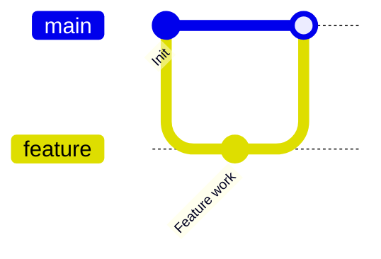
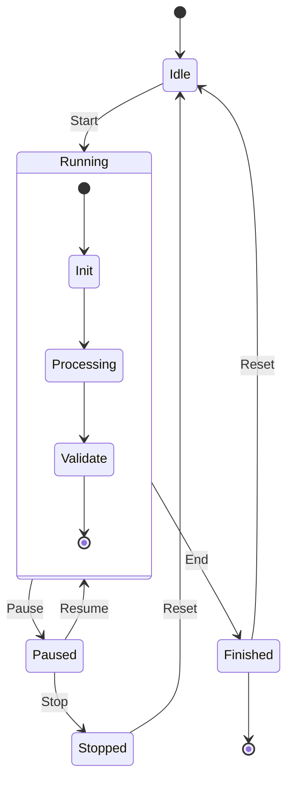
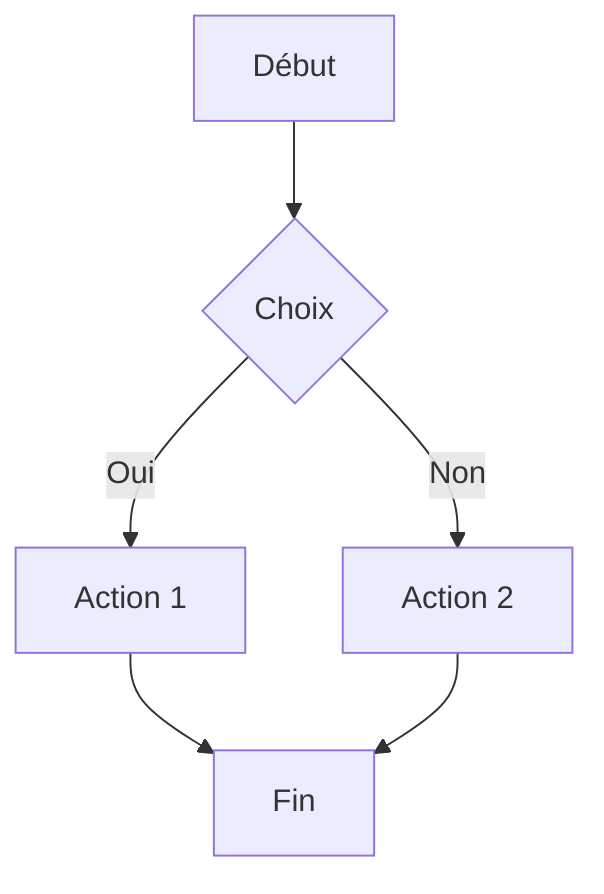
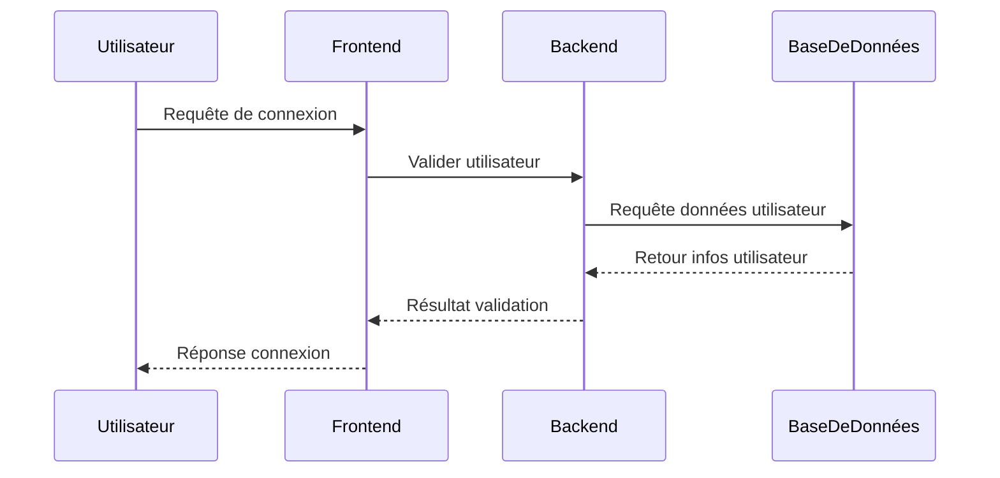

# Grab Food Guesser

<div align="center">
  
</div>

## Aim of the project

## Contents

- [Installation](#installation)
- [Usage](#usage)
- [Data Bases](#data-bases)
- [Contributing](#contributing)

# Installation

Follow these steps to install and run the project locally.

### 1. Download the project

- Download the project ZIP file.
- Extract its contents into a folder.
- Open the project folder in your preferred IDE.

### 2. Configure environment variables

- Create a `.env` file in the root directory of the project.
- Add your local MySQL database password:

```env
DATABASE_PASSWORD='your_password'
```

Replace `your_password` with your actual MySQL password.

### 3. Set up the database

- Start your MySQL server.
- Connect to your local MySQL instance.
- Open the SQL scripts provided in the project.
- Execute the scripts to create and initialize the database.

### 4. Install dependencies

Make sure [Node.js](https://nodejs.org/) is installed on your computer.

Open a terminal in the project's root directory and run:

```bash
npm install
```

If Express is not already listed as a dependency, install it with:

```bash
npm install express
```

### 5. Start the application

Run the following command in your terminal:

```bash
node app.js
```

### 6. Access the application

Once the server has started successfully, open your browser and navigate to:

[http://localhost:3000/](http://localhost:3000/)

The web application should now be accessible locally.

## Usage

Run the command with a project path.

## Data Bases

## Markdown Schema vs Other Documentation Tools

| Feature                      | Markdown (.md)        | dbdiagram.io / DrawSQL | Confluence / Notion | pgAdmin / DataGrip  | SchemaSpy / tbls       |
| ---------------------------- | --------------------- | ---------------------- | ------------------- | ------------------- | ---------------------- |
| Version controlled in git    | Yes                   | Export only            | No                  | No                  | Re-generate each time  |
| AI assistants can read it    | Natively              | No                     | Poorly              | No                  | Partially              |
| Free and open                | Yes                   | Freemium               | Paid                | Varies              | Yes                    |
| Works offline                | Yes                   | No                     | No                  | Yes                 | Yes (after generation) |
| Reviewable in pull requests  | Yes                   | No                     | No                  | No                  | Yes (if committed)     |
| Includes business context    | Yes (authored)        | No (visual only)       | Yes (if maintained) | No (structure only) | No (auto-generated)    |
| Setup required               | None                  | Account signup         | Account + setup     | Installation        | Installation + config  |
| Stays in sync with code      | Same PR as migrations | Manual export          | Manual update       | Live connection     | Re-run on each change  |
| Human-readable without tools | Yes                   | Need browser           | Need browser        | Need application    | Need browser           |
| Supports query examples      | Yes                   | No                     | Yes                 | No                  | No                     |
| Documents business rules     | Yes                   | No                     | Yes (if maintained) | No                  | No                     |
| Migration history tracking   | Yes                   | No                     | Manual              | No                  | No                     |

**The key advantage of markdown**: it is the only format that combines version control, AI readability, business context, and zero dependencies in a single file. Other tools excel at visualization or auto-generation, but none match markdown for maintaining a living, reviewed, AI-readable schema document.

---







## How to Format Database Schemas in Markdown

This section shows the markdown syntax patterns for documenting each type of schema information. Use these patterns consistently throughout your schema.md file for maximum readability.

### Table Definitions

Use fenced SQL code blocks for CREATE TABLE statements. Include constraints, defaults, and CHECK clauses inline so the full structure is visible at a glance:

```sql
CREATE TABLE IF NOT EXISTS produit (
    id INT AUTO_INCREMENT PRIMARY KEY,
    nom VARCHAR(255) NOT NULL,
    nom_restaurant VARCHAR(255) NOT NULL,
    prix DECIMAL(10, 2) NOT NULL,
    image VARCHAR(255)
);
CREATE TABLE IF NOT EXISTS partie (
    id INT AUTO_INCREMENT PRIMARY KEY,
    score DECIMAL(10, 2) DEFAULT 0,
    round INT DEFAULT 1,
    hint_count INT DEFAULT 2,
    temp_count INT DEFAULT 2,
    produit_actuel INT,
    FOREIGN KEY (produit_actuel) REFERENCES produit(id)
);
CREATE TABLE IF NOT EXISTS users (
    id INT AUTO_INCREMENT PRIMARY KEY,
    nickname VARCHAR(255) NOT NULL UNIQUE,
    email VARCHAR(255) NOT NULL UNIQUE,
    hash_password VARCHAR(255) NOT NULL,
    creation_date datetime NOT NULL DEFAULT CURRENT_TIMESTAMP,
    user_role ENUM('Admin', 'Player') DEFAULT 'Player' NOT NULL
);
```

### Column Reference Tables

Use markdown tables to provide column-by-column documentation with business context. This is where you add the meaning that SQL alone cannot express:

| Column        | Type                    | Nullable | Default           | Description                                             |
| ------------- | ----------------------- | -------- | ----------------- | ------------------------------------------------------- |
| id            | UUID                    | No       | -                 | Primary key, auto-generated server-side                 |
| nickname      | VARCHAR(255)            | No       | -                 | Login email, globally unique, case-insensitive matching |
| email         | VARCHAR(255)            | No       | -                 | Display name shown in the application UI                |
| hash_password | VARCHAR(255)            | No       | -                 | Permission level: admin, member, or viewer              |
| creation_date | datetime                | No       | CURRENT_TIMESTAMP | Account creation time (stored as UTC)                   |
| user_role     | ENUM('Admin', 'Player') | No       | 'Player'          | Soft delete marker (null = active record)               |

### Entity Relationship Diagrams

Use text-based diagrams to show how tables connect. Keep them simple and readable in plain text:



For more detail, add a relationship reference table documenting foreign keys and delete behavior:

| Parent | Child     | FK Column | Cardinality | ON DELETE | Notes                                |
| ------ | --------- | --------- | ----------- | --------- | ------------------------------------ |
| users  | posts     | author_id | 1:N         | CASCADE   | Deleting user deletes their posts    |
| users  | comments  | author_id | 1:N         | CASCADE   | Deleting user deletes their comments |
| posts  | comments  | post_id   | 1:N         | CASCADE   | Deleting post deletes its comments   |
| posts  | post_tags | post_id   | 1:N         | CASCADE   | Junction table for many-to-many      |
| tags   | post_tags | tag_id    | 1:N         | CASCADE   | Junction table for many-to-many      |

### Business Rules

Use bullet lists to document rules enforced in application code, not just database constraints. These are critical for AI assistants and new developers:

**Business Rules**:

- Users cannot delete their account if they have published posts with comments from other users
- Email addresses are matched case-insensitively (stored as lowercase)
- The 'admin' role can only be assigned by another admin
- Soft-deleted records are excluded from all API responses but retained for 90 days
- Posts with status 'published' cannot be moved back to 'draft'

# Contributing

- [Mathias](https://github.com/mathas42) :
- [ Matthieu](https://github.com/MatthieuGalland) :
- [Timothée](https://github.com/Elfvelour) :
